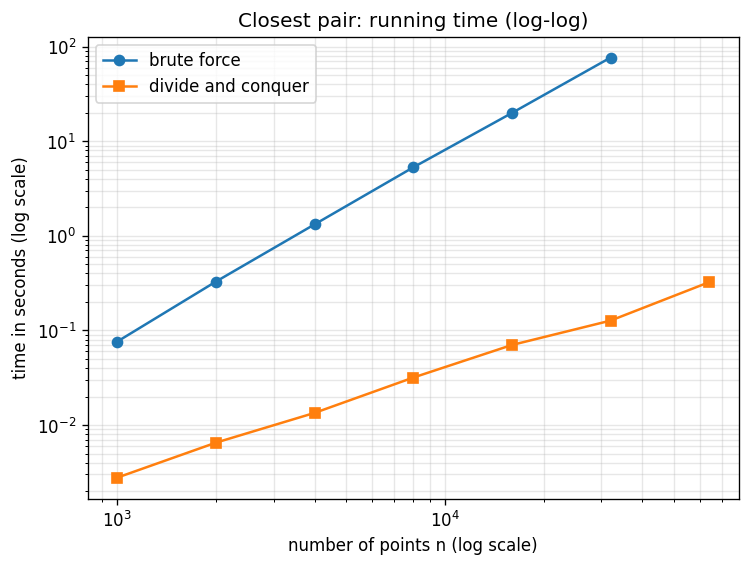
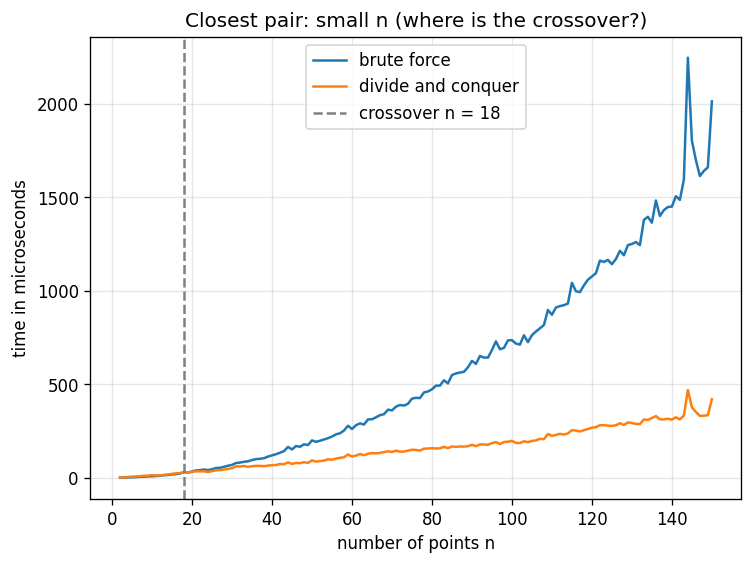

# Assignment 2: Closest Camera Traps

**CSF302, Units 2–4 · Student ID: 02240340**

> **AI declaration:** I used Claude (an AI tool) to help write the first version of the code, the tests, the analysis script and this report. I checked all the code against my brute-force function (1,500 random inputs of 2–50 points, plus the special cases), and all 11 tests pass. I ran the timings on my own laptop, and I went through every explanation until I understood it.

**Files:** `closest.py` (Part A), `test_closest.py` (Part B), `analysis.py` (Part C: makes `results.md`, `graph_loglog.png` and `graph_crossover.png`).
**Set-up:** Python 3.11.5 on Windows 11. Run the tests with `python -m pytest test_closest.py -v`.

---

## 1. The code (Part A)

Both functions take a list of points `(x, y)` and return `(d, i, j)`: the smallest distance and the indices `i < j` of the two closest points. Inside the code I compare **squared** distances (`dx*dx + dy*dy`), so no square root is needed until the very end. The smaller distance always has the smaller square, so the answer is the same.

| Function | Idea |
|---|---|
| `closest_pair_brute` | Two loops: compare every point with every later point and keep the closest pair. About n²/2 comparisons, so Θ(n²). |
| `closest_pair` | Sort the points by x once. Split the list in the middle. Solve the left half and the right half. Let δ be the best distance from the two halves. Then check the **strip**: the points within δ of the dividing line, so the strip is 2δ wide. |

How the strip check works:
- Each recursive call also returns its points **sorted by y**. I build this by merging the two halves like in merge sort, so I never have to sort again.
- I go up the strip in y order. Each point is compared only with the points above it, and I **stop as soon as the y gap alone is ≥ δ**. Only a few points (at most 7) fit inside a δ × 2δ box, so this loop is O(n) in total.
- Each point keeps its original index, so the answer gives the indices from the input list.

On the example from the assignment, both functions return **(1.414…, 0, 5)**, which is the points (2, 3) and (3, 4).

## 2. Testing (Part B)

**All 11 tests pass** (`python -m pytest test_closest.py -v`, 0.7 s).

- **Against brute force:** 500 random inputs of 2–50 points on a big grid, 500 on a tiny 0–10 grid (lots of equal x values, equal distances and duplicates), and 500 with decimal coordinates. Each time the distances must be equal, and the returned pair must really be that distance apart.
- **Special cases:**
  - exactly 2 points: `[(0,0), (3,4)]` gives `(5.0, 0, 1)`
  - duplicate points: `(7,7)` twice gives distance **0**
  - all points the same
  - all points on one vertical line (`x = 4`), plus 100 random vertical-line inputs
  - **closest pair across the dividing line:** 8 points where each half's best is about 25, but `(10, 50)` on the left and `(11, 50)` on the right are only 1 apart. Without the strip check this test fails.
  - one bigger input of 2,000 points against brute force

When two pairs are equally close, the two functions can return different pairs. Both answers are correct, so the random tests compare the **distance**, not the indices.

## 3. Analysis (Part C)

### C1. Recurrence and Master Method

For n points, `solve` does:
- two recursive calls on n/2 points each → **2T(n/2)**
- splitting the list, merging the y-sorted halves, building the strip and scanning it (each point is compared with at most 7 others) → **Θ(n)**

So **T(n) = 2T(n/2) + Θ(n)**, and T(n) = Θ(1) when n ≤ 3.

Master Method: a = 2, b = 2, f(n) = Θ(n).
n^(log_b a) = n^(log₂ 2) = n¹ = n.
f(n) = Θ(n^(log_b a)), so this is **Case 2**, and **T(n) = Θ(n log n)**.

The sort by x at the start is also Θ(n log n), so the whole of `closest_pair` is **Θ(n log n)**. Brute force is **Θ(n²)**.

### C2. Timing results

Random points on a 1,000,000 × 1,000,000 grid. Divide and conquer is the best of 3 runs. Brute force ran once per size. It took over 60 s at n = 32,000, so I stopped it there and did not run it at 64,000.

**Table 1: Running time in seconds**

| n | Brute force (s) | Divide & conquer (s) | Brute / D&C |
|---|---|---|---|
| 1,000 | 0.076 | 0.0028 | 27× |
| 2,000 | 0.329 | 0.0065 | 50× |
| 4,000 | 1.323 | 0.0134 | 98× |
| 8,000 | 5.298 | 0.0318 | 167× |
| 16,000 | 19.907 | 0.0702 | 284× |
| 32,000 | 76.656 | 0.1271 | 603× |
| 64,000 | stopped (over 60 s) | 0.3240 | – |

**Table 2: How much longer each one takes when n doubles**

| n | Brute force | Divide & conquer |
|---|---|---|
| 2,000 | 4.31 | 2.34 |
| 4,000 | 4.02 | 2.06 |
| 8,000 | 4.00 | 2.36 |
| 16,000 | 3.76 | 2.21 |
| 32,000 | 3.85 | 1.81 |
| 64,000 | – | 2.55 |

Θ(n²) should give ×4 each time, and brute force gives about 4. Θ(n log n) should give a bit more than ×2, and divide and conquer gives about 2.2.

**Figure 1: Log-log graph of running time**

On a log-log graph, the slope tells us the power of n. Brute force has slope **1.99** (n² gives 2). Divide and conquer has slope **1.14**. Pure n would give 1.00, and n log n over this range gives about 1.11, so 1.14 fits n log n.

### C3. Crossover point

For small n the times are tiny, so each function was run 20 times on each of 20 random inputs for every n from 2 to 150, and I took the average.

**Table 3: Average time for small n (microseconds)**

| n | Brute force | Divide & conquer | Faster |
|---|---|---|---|
| 2 | 0.5 | 1.1 | brute |
| 5 | 2.4 | 5.4 | brute |
| 10 | 8.3 | 13.8 | brute |
| 20 | 33.3 | 30.7 | D&C |
| 50 | 199.9 | 93.1 | D&C |
| 100 | 736.0 | 197.6 | D&C |
| 150 | 2012.8 | 419.9 | D&C |

**Figure 2: Small n, showing the crossover**

**On my laptop, divide and conquer becomes faster at n = 18**, and it stays faster for every n I tested after that (up to 150). Below 18, brute force wins. (The spike near n = 145 is noise from the computer doing something else at that moment.)

## 4. Critical Reflection (Part D)

**Q1. Did my measured growth match the recurrence?**
Yes. The recurrence gives Θ(n log n). When n doubled, divide and conquer took about 2.2 times longer, which is a little more than 2 because of the extra log n. The log-log slope was 1.14, close to the 1.11 that n log n should give over this range. The doubling ratios were not exactly the same each time (1.81 to 2.55), because these runs only take 0.003–0.3 s, so small delays from Windows or Python's memory handling make a big difference. Brute force matched Θ(n²) very well: about ×4 per doubling and a slope of 1.99.

**Q2. Why is brute force faster for small n, even though it is Θ(n²)?**
Big-O hides the constant factors. Brute force does only a little work per pair: subtract, multiply, add, compare. Divide and conquer has more work for each point: it makes a new tuple with the index, sorts, makes recursive function calls, slices lists, merges the y lists and builds the strip. Function calls and new lists are slow in Python. With 10 points, brute force does only 45 comparisons, which is cheaper than all that setup. The n² part only becomes bigger than this extra work at about n = 18 on my machine.

**Q4. How I used an AI tool and checked it.**
I used Claude to write the first version of the code and tests. It got the main algorithm right: merging by y instead of sorting the strip again, so the recurrence really is 2T(n/2) + Θ(n). One thing it did not get right at first was the analysis script. It had an extra line that ran brute force a second time at every size, which would have doubled the long timing runs. I removed it, because the tests already check correctness. I checked the code mainly with the brute-force tests. The tiny-grid test was very useful because it creates many ties and duplicate points. I also made sure the "crosses the dividing line" test really needs the strip check, so I know the tests can catch that mistake.
