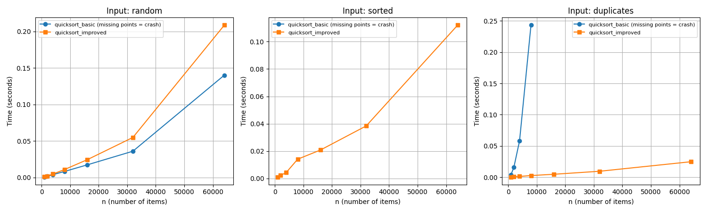
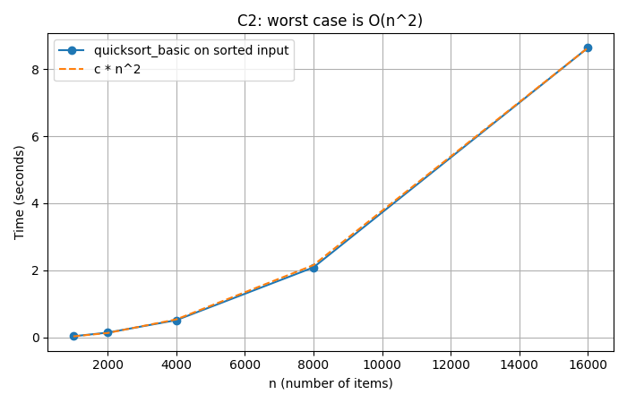
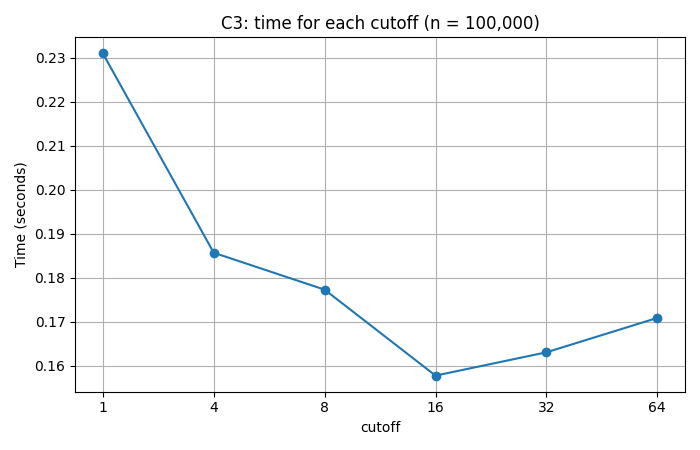
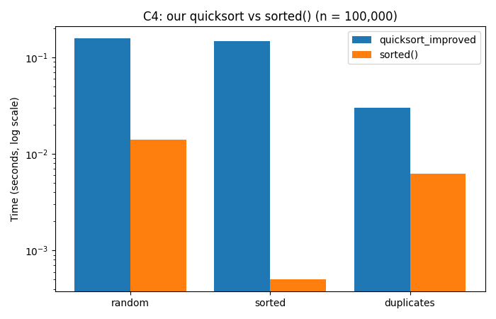

# Assignment 3: Fixing a Slow Quicksort

**CSF302, Unit 5 · Student ID: 02240340**

> **AI declaration:** I used Claude (an AI tool) to help write the first version of the code, the timing script and this report. I checked all the code with my own tests against `sorted()` (500+ random lists and all the special cases, and all tests pass). I ran all the timings on my own laptop, and I wrote the explanations so that I understand them.

**Files:** `sorts.py` (Part A), `test_sorts.py` (Part B), `analysis.py` (Part C, makes `results.md` and 4 graphs).
**Set-up:** Python 3.11.5 on Windows 11. Each time is the fastest of 3 runs, in seconds.

---

## 1. The code (Part A)

**`quicksort_basic(a)`** uses the last element as the pivot (Lomuto partition) and then sorts the left part and the right part with recursion.

**`quicksort_improved(a, cutoff=16)`** has 4 fixes:

| Fix | What it does | Why it helps |
|---|---|---|
| Random pivot | Picks the pivot at a random position. | Sorted data is no longer a bad case. |
| Insertion sort for small parts | If a part has `cutoff` items or fewer, it uses insertion sort. | Saves many small recursive calls. |
| Recurse on the smaller part, loop on the bigger part | Only the smaller part gets a new function call. | The smaller part is at most half the size, so there are at most log₂ n nested calls (about 17 for 100,000 items). No more `RecursionError`. |
| Three-way partition | Splits into **smaller / equal / bigger** than the pivot. | All copies of the pivot are finished in one step, so repeated values (like Nu 100 and Nu 500) are fast. |

## 2. Testing (Part B)

Run `python -m pytest test_sorts.py -v`. **All 6 tests pass.** The tests check:

- 500 random lists for **each** sort, compared with `sorted()`.
- Special cases for both sorts: an empty list, one element, all equal, already sorted, reverse sorted, and negative numbers.
- `quicksort_improved` with every cutoff (1, 4, 8, 16, 32, 64).
- `quicksort_improved` on 100,000 sorted, reverse, duplicate and all-equal items. These are the inputs that break the basic sort.

## 3. Timing results (Part C1)

| n | basic: random | improved: random | basic: sorted | improved: sorted | basic: duplicates | improved: duplicates |
|---|---|---|---|---|---|---|
| 1,000 | 0.0007 | 0.0010 | RecursionError | 0.0011 | 0.0039 | 0.0003 |
| 2,000 | 0.0016 | 0.0020 | RecursionError | 0.0022 | 0.0155 | 0.0005 |
| 4,000 | 0.0039 | 0.0048 | RecursionError | 0.0043 | 0.0581 | 0.0012 |
| 8,000 | 0.0082 | 0.0108 | RecursionError | 0.0140 | 0.2432 | 0.0026 |
| 16,000 | 0.0173 | 0.0243 | RecursionError | 0.0208 | RecursionError | 0.0046 |
| 32,000 | 0.0360 | 0.0549 | RecursionError | 0.0384 | RecursionError | 0.0094 |
| 64,000 | 0.1401 | 0.2086 | RecursionError | 0.1120 | RecursionError | 0.0247 |

**What the results show:**
- **Random data:** both sorts are fast, O(n log n). The basic one is a little faster here, because the improved one does extra work: it picks a random number and does more swaps.
- **Sorted data:** the basic sort **crashes every time**, even at n = 1,000. It needs about n nested calls, and Python only allows about 1,000. The improved sort has no problem.
- **Duplicates (values 0 to 9):** the basic sort gets about **4× slower each time n doubles** (0.0155 → 0.0581 → 0.2432), which means O(n²). It crashes from n = 16,000. The improved sort is fastest on this input, because the three-way partition puts all equal values in place at once.

## 4. Why the basic quicksort is slow on sorted data (Part C2)

If the list is already sorted, the last element is the **biggest**. So all the other n − 1 elements go to the left part and the right part is empty. Each call does about n steps of work, and then only one element has been removed:

T(n) = T(n − 1) + n
  = n + (n − 1) + (n − 2) + … + 1
  = n(n + 1) / 2 = **O(n²)**

This also means **n calls inside each other**, which causes the `RecursionError`.

To check the O(n²) time, I raised Python's recursion limit to 20,000 so that the sort could finish:

| n | time (s) | time ÷ previous time |
|---|---|---|
| 1,000 | 0.0377 | – |
| 2,000 | 0.1459 | 3.87 |
| 4,000 | 0.5163 | 3.54 |
| 8,000 | 2.0893 | 4.05 |
| 16,000 | 8.6314 | 4.13 |

When n doubles, the time becomes about **4 times bigger** (2² = 4), which is what O(n²) predicts. At n = 16,000 the basic sort needs 8.6 s and the improved sort needs only 0.02 s.

## 5. Choosing the cutoff (Part C3)

`quicksort_improved` on 100,000 random numbers (fastest of 5 runs):

| cutoff | 1 | 4 | 8 | 16 | 32 | 64 |
|---|---|---|---|---|---|---|
| time (s) | 0.2309 | 0.1856 | 0.1772 | **0.1577** | 0.1630 | 0.1708 |

**Best cutoff: 16.** It is about 32% faster than cutoff = 1 (no insertion sort). A bigger cutoff such as 64 gets slower again, because insertion sort is O(k²) and becomes slow on bigger parts. The values from 16 to 32 are very close, so either is a good choice.

## 6. Comparison with Python's `sorted()` (Part C4)

n = 100,000, `quicksort_improved` with cutoff = 16:

| input | quicksort_improved (s) | sorted() (s) | sorted() is faster by |
|---|---|---|---|
| random | 0.1563 | 0.0140 | 11× |
| sorted | 0.1474 | 0.0005 | 295× |
| duplicates | 0.0299 | 0.0063 | 5× |

`sorted()` uses **Timsort**, which is written in C. It is faster on every input. On sorted data it is much faster, because Timsort notices that the list is already in order and finishes in O(n).

---

## 7. Critical reflection (Part D)

**1. Why did the basic quicksort fail on sorted data, and which assumption was broken?**
The average-case analysis of quicksort says O(n log n), but it **assumes the input is in random order**. Then the pivot usually lands near the middle and the two parts are about the same size. The bank's data is already sorted, so the last element is always the biggest and the split is always (n − 1, 0). That gives T(n) = T(n − 1) + n = O(n²). My results confirm this: the time grew about 4× each time n doubled. Because there were also n nested calls, Python crashed already at n = 1,000. Repeated amounts cause the same problem, because all values equal to the pivot go to one side. The random pivot fixes the sorted case, recursing on the smaller part fixes the crash, and the three-way partition fixes the duplicates.

**2. Insertion sort is O(n²). Why does it make quicksort faster?**
O(n²) describes what happens when n is large. For a part of 16 items, the constant cost matters more than the growth. Insertion sort is one simple loop: no function calls, no random numbers, and few swaps. Quicksort on the same 16 items would make about 30 small function calls, and function calls are slow in Python. In my test, cutoff 16 was about 32% faster than cutoff 1. At cutoff 64 the O(k²) cost started to show, and it became slower again.

**3. Why is `sorted()` still faster, and is it the algorithm or the language?**
On random data `sorted()` was 11× faster. Both algorithms are O(n log n), and Timsort makes only about 1.4× fewer comparisons than quicksort. So most of the difference (about 8×) comes from the **language**: my code runs line by line in the Python interpreter, but Timsort is compiled C code. On sorted data the gap was 295×. Here the **algorithm** matters most: Timsort finishes sorted input in O(n), while quicksort still does O(n log n) work. That alone is about 17× (log₂ 100,000 ≈ 17), and the language explains the rest. So on random data the gap comes mostly from the language, and on sorted data mostly from the algorithm.
