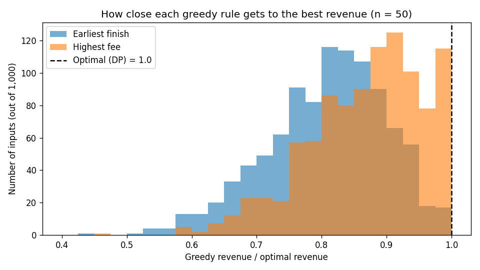

# Assignment 4: Booking the Hall

**CSF302, Units 6–7 · Student ID: 02240340**

> **AI declaration:** I used Claude (an AI tool) to help write the first version of the code, the tests, the analysis script and this report. I checked all the code against my brute-force function (500 random inputs of 0–10 requests), and all 11 tests pass. I ran the analysis on my own laptop, and I went through every explanation until I understood it.

**Files:** `booking.py` (Part A), `test_booking.py` (Part B), `analysis.py` (Part C: makes `results.md` and `graph_ratios.png`).
**Set-up:** Python 3.11.5 on Windows 11. Run the tests with `python -m pytest test_booking.py -v`.

---

## 1. The code (Part A)

Each request is `(start, finish, fee)`. Two requests **fit** if one finishes no later than the other starts, so `(9, 12)` and `(12, 14)` fit. Every function returns `(total_fee, chosen)`.

| Function | Idea |
|---|---|
| `greedy_earliest_finish` | Sort by finish time. Go through the list and accept a request if it starts at or after the finish of the last accepted one. |
| `greedy_highest_fee` | Sort by fee, biggest first. Accept a request if it fits with every request already accepted. |
| `best_schedule` (DP) | Sort by finish time. `p(j)` = the last request that ends before request *j* starts. Fill the table `OPT(j) = max(OPT(j−1), fee_j + OPT(p(j)))`, then go backwards through the table to find which requests were taken. |
| `brute_force` | Try every subset. Keep the subset with no overlaps that earns the most. Only used for checking. |

On the example from the assignment, `greedy_earliest_finish` gives **(7500, [0, 3, 4])** and `best_schedule` gives **(10000, [1, 4])**, which is what the assignment expects.

## 2. Testing (Part B)

**All 11 tests pass.** The tests check:

- **DP vs brute force:** 500 random inputs with 0 to 10 requests. The DP total must equal the brute-force total, and the chosen requests must not overlap and must add up to that total.
- **Greedy answers are real schedules:** they never double-book the hall and never earn more than the best.
- **Special cases:** no requests, one request, all overlapping (only the biggest fee is taken), none overlapping (all are taken), and back-to-back requests (9–12, 12–15, 15–18 are all taken).
- **Equal fees:** on 500 random inputs where every fee is Nu 1000, `greedy_earliest_finish` always earns the best total.
- **The counterexamples from Part C1** really do make each greedy rule lose money.

## 3. Analysis (Part C)

### C1. Counterexamples

| Rule | Requests (start, finish, fee) | Greedy picks | Greedy earns | Best (DP) | Best earns |
|---|---|---|---|---|---|
| Earliest finish | (0, 2, 1000), (1, 5, 5000) | request 0 | Nu 1000 | request 1 | **Nu 5000** |
| Highest fee | (0, 10, 5000), (0, 5, 3000), (5, 10, 3000) | request 0 | Nu 5000 | requests 1 and 2 | **Nu 6000** |

- **Why earliest finish fails:** it looks only at the time and ignores the money. The short Nu 1000 event ends first, so it is taken, and it blocks the Nu 5000 event.
- **Why highest fee fails:** it looks only at one fee at a time. The Nu 5000 event fills the whole day. Two smaller events (Nu 3000 + Nu 3000) could use the same time and earn more together.

### C2. Why the DP recurrence is correct

Sort the requests by finish time and look at the **last** request, *j*. The best schedule of requests 1..*j* either uses *j* or it does not:

1. **It does not use *j*.** Then it is just the best schedule of requests 1..*j*−1, which is **OPT(*j*−1)**.
2. **It uses *j*.** Then every other request in it must end before *j* starts, so they all come from requests 1..*p(j)*. Those other requests must also be the **best** schedule of 1..*p(j)*. If they were not, we could swap in a better set and earn more, which is impossible. So the total is **fee_j + OPT(*p(j)*)**.

The best schedule is one of these two cases, so OPT(*j*) is the bigger one. This is **optimal substructure**: the best answer for a big problem is built from the best answers to smaller problems. The base case is OPT(0) = 0 (no requests means no money). Greedy makes one choice and never checks it. The DP compares both choices at every step, so it cannot miss the best answer.

### C3. Greedy revenue compared with the optimum

1,000 random inputs, each with 50 requests (start 0–100, length 1–20 hours, fee Nu 500–10,000). Ratio = greedy revenue ÷ optimal revenue (1.000 = as good as the best).

| Rule | Average ratio | Worst ratio | Inputs where greedy was optimal |
|---|---|---|---|
| Earliest finish | 0.809 | 0.445 | 5 / 1000 |
| Highest fee | 0.870 | 0.459 | 63 / 1000 |
| DP (`best_schedule`) | 1.000 | 1.000 | 1000 / 1000 |

**What the results show:** on average, earliest finish loses about **19%** of the possible money and highest fee loses about **13%**. In the worst case, both rules earn **less than half** of the best. Earliest finish was optimal only 5 times out of 1,000, so with 50 requests it almost never finds the best answer.

### C4. Time complexity (n = number of requests)

| Function | Time | Why |
|---|---|---|
| `greedy_earliest_finish` | **O(n log n)** | Sorting is O(n log n). The loop is O(n). |
| `greedy_highest_fee` | **O(n²)** | Sorting is O(n log n), but each request is checked against every accepted request. |
| `best_schedule` | **O(n log n)** | Sorting is O(n log n). Finding each `p(j)` with binary search is O(log n), so n times is O(n log n). Filling and reading the table is O(n). |
| `brute_force` | **O(2ⁿ · n²)** | There are 2ⁿ subsets, and checking one subset for overlaps takes up to n² pairs. |

The DP is as fast as the simple greedy rule (both O(n log n)) and always gives the best answer.

## 4. Critical reflection (Part D)

**Q1. What does testing tell us about correctness?**
Highest fee gave the right answer (Nu 10,000) on the assignment's own example, so one test made it look correct. In my experiment it was optimal on 63 out of 1,000 inputs, so a few lucky tests could easily pass. But one counterexample with only three requests shows that it is wrong. Tests can show that code is **wrong**, but passing tests cannot prove it is **right**. The DP is different because I have an argument (C2) that covers every input, and the 500 brute-force tests support that argument.

**Q2. Should the manager keep the simple rule?**
No. Earliest finish earns on average only 80.9% of the best revenue, and on a bad day only 44.5%. So the manager loses about one-fifth of the money, and sometimes more than half. The DP has the same running time, O(n log n), and with a computer it gives the answer at once. The simple rule only makes sense if the manager has to decide by hand straight away, before all the requests have arrived.

**Q3. Why does greedy work when fees are equal?**
When every fee is the same, more money just means more events. Taking the event that finishes first leaves the most free time for the rest. Any best schedule can swap its first event for the earliest-finishing one and still fit the same number of events, so the greedy choice is always safe. My 500 equal-fee tests agree. When the fees are different, the number of events is no longer the goal. A short cheap event can block a long expensive one (C1), so the earliest-finish choice is no longer safe and we need DP to compare both options.
