# Question 1

## 1. Linear Search
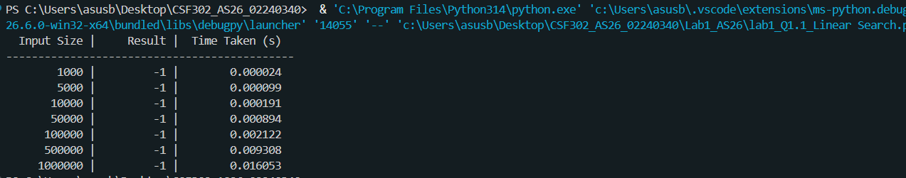

## 2. Binary Search
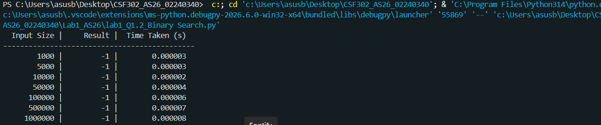

## 3. Generate random datasets of different sizes.
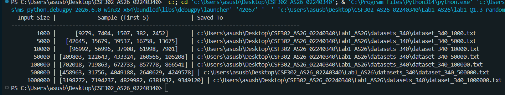

## 4. Sort the dataset before applying Binary Search.
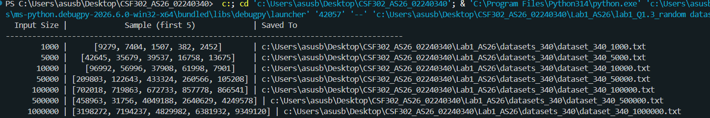

## 5. Measure the average execution time for both algorithms.
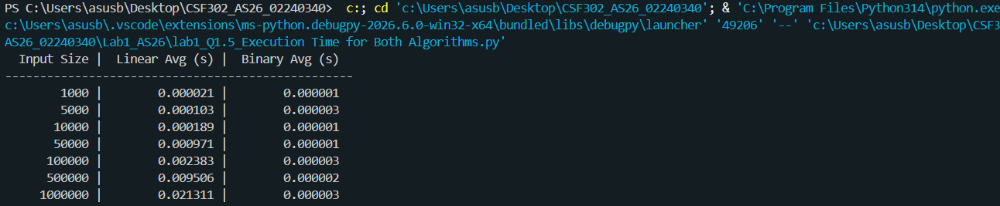

# Question 2

## 1. Implement Bubble Sort.
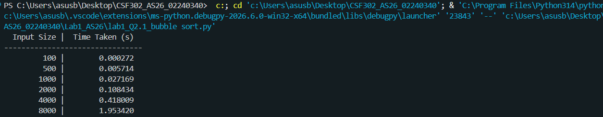

## 2. Implement Merge Sort.
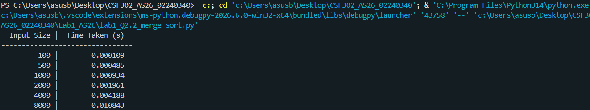

## 3. Generate random arrays.
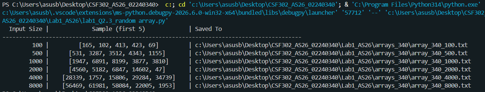

## 4. Measure average execution time.
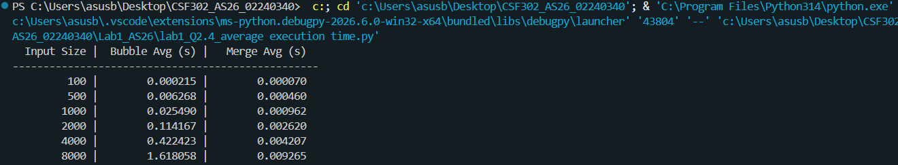

# Question 3
Compare different methods of generating prime numbers and analyze their empirical performance.

## 1. Naive Prime Checking using Trial Division
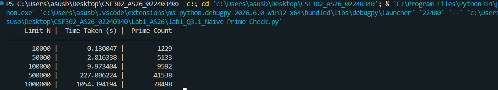

## 2. Optimized Trial Division (checking up to √n)
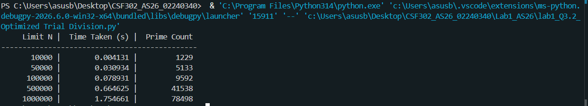

## 3. Sieve of Eratosthenes
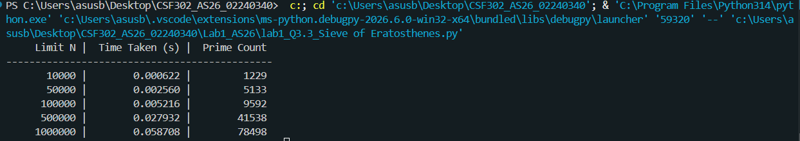